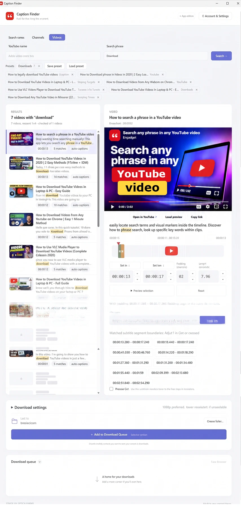

<!-- languages:start -->

<b>🌐 Language · Idioma · Langue · Sprache · Язык · 语言 · 言語 · 언어 · भाषा · لغة</b>

 

<table>
  <tr>
    <td align="center"><a href="../../README.md">English</a></td>
    <td align="center"><a href="README.ar.md">العربية</a></td>
    <td align="center"><a href="README.bn.md">বাংলা</a></td>
    <td align="center"><a href="README.zh-Hans.md">简体中文</a></td>
    <td align="center"><a href="README.fil.md">Filipino</a></td>
  </tr>
  <tr>
    <td align="center"><a href="README.fr.md">Français</a></td>
    <td align="center"><a href="README.de.md">Deutsch</a></td>
    <td align="center"><a href="README.hi.md">हिन्दी</a></td>
    <td align="center"><a href="README.id.md">Bahasa Indonesia</a></td>
    <td align="center"><a href="README.it.md">Italiano</a></td>
  </tr>
  <tr>
    <td align="center"><a href="README.ja.md">日本語</a></td>
    <td align="center"><a href="README.ko.md">한국어</a></td>
    <td align="center"><a href="README.fa.md">فارسی</a></td>
    <td align="center"><a href="README.pt-BR.md">Português (Brasil)</a></td>
    <td align="center"><a href="README.ru.md">Русский</a></td>
  </tr>
  <tr>
    <td align="center"><a href="README.es.md">Español</a></td>
    <td align="center"><b>తెలుగు</b></td>
    <td align="center"><a href="README.th.md">ไทย</a></td>
    <td align="center"><a href="README.tr.md">Türkçe</a></td>
    <td align="center"><a href="README.vi.md">Tiếng Việt</a></td>
  </tr>
</table>

<!-- languages:end -->

# Caption Finder

> ఈ అనువాదాన్ని AI రాసింది, దీనిని మాతృభాష మాట్లాడే వారెవరూ సమీక్షించలేదు. యాప్ ఈ భాషలో కూడా అందుబాటులో ఉంది, బటన్లు, మెనూల పేర్లను యాప్ చూపించే విధంగానే ఇక్కడ ఇచ్చాం (భాషను Account & Settings → Language లో మార్చవచ్చు). సందేహం ఉన్నప్పుడు [ఇంగ్లీష్ README](../../README.md)నే ప్రమాణం.

YouTube వీడియోలలో ఒక పదబంధం ఎప్పుడు పలకబడిందో కనుగొనండి, మీకు నచ్చిన భాగాన్ని ఎంచుకోండి, కత్తిరించిన క్లిప్‌ను డౌన్‌లోడ్ చేయండి.

ఒక పదబంధాన్ని టైప్ చేయండి, యాప్‌ను ఒక ఛానెల్ వైపు, అనేక ఛానెళ్ల వైపు లేదా వీడియోల జాబితా వైపు చూపించండి, అది వాటి క్యాప్షన్లను స్కాన్ చేస్తుంది. సరిపోలిన ఫలితాలు ఎడమ వైపు జాబితాలో నిండుతాయి. ఒకదాన్ని ఎంచుకోండి, వీడియో కుడి వైపు లోడ్ అవుతుంది, ఆ పంక్తి చుట్టూ ఇన్, అవుట్ పాయింట్లు ముందే అమర్చబడి ఉంటాయి. వాటిని సరిచేయండి, ప్రివ్యూ చూడండి, ఆ భాగాన్ని మాత్రమే డౌన్‌లోడ్ చేయండి.

  

> మీ స్వంతమైన లేదా డౌన్‌లోడ్ చేయడానికి మీకు అనుమతి ఉన్న కంటెంట్‌ను మాత్రమే డౌన్‌లోడ్ చేయండి.

## ఇన్‌స్టాల్ చేయడం (Windows)

[రిలీజ్‌ల పేజీ](https://github.com/MolecularDust/Caption-Finder/releases) నుండి సెటప్ పొందండి: `Caption-Finder-Setup_<version>_x64.exe`. దీనికి x64 PCలో Windows 11 అవసరం. యాప్ ఉపయోగించే WebView2 రన్‌టైమ్ Windows 11లో చేర్చబడి ఉంటుంది.

1. Caption Finder నడుస్తుంటే దాన్ని మూసివేయండి.
2. సెటప్‌పై డబుల్-క్లిక్ చేయండి. యాప్ కోడ్-సైన్ చేయనిది కాబట్టి అది తెలియని పబ్లిషర్ నుండి అని Windows హెచ్చరించవచ్చు. **More info** క్లిక్ చేసి, ఆపై **Run anyway** క్లిక్ చేయండి.
3. ఒక ఎంపికను ఎంచుకోండి:
   - **Install normally:** అడ్మినిస్ట్రేటర్ హక్కులు లేకుండా మీ యూజర్ ఖాతా కోసం ఇన్‌స్టాల్ చేస్తుంది. Start మెనూ షార్ట్‌కట్‌ను, ఇన్‌స్టాల్ చేసిన యాప్‌ల జాబితాలో (Apps & features) ఒక ఎంట్రీని జోడిస్తుంది.
   - **Portable:** యాప్‌ను మీరు ఎంచుకున్న ఫోల్డర్‌కు, ఉదాహరణకు USB డ్రైవ్‌కు కాపీ చేస్తుంది. Start మెనూకి లేదా రిజిస్ట్రీకి ఏదీ జోడించబడదు, సెట్టింగ్‌లు యాప్ పక్కన ఉన్న `Data` ఫోల్డర్‌లో ఉంటాయి.
4. **Install** క్లిక్ చేసి, ఆపై **Finish** క్లిక్ చేయండి.

సాధారణ ఇన్‌స్టాలేషన్‌ను తొలగించడానికి ఇన్‌స్టాల్ చేసిన యాప్‌ల జాబితాను (Apps & features) ఉపయోగించండి. మీ సెట్టింగ్‌లు, సైన్-ఇన్ డేటా మీ యూజర్ ప్రొఫైల్‌లోనే ఉంటాయి.

అదే పేజీ నుండి మీరు `Caption-Finder-Windows-Portable.zip`ను కూడా డౌన్‌లోడ్ చేయవచ్చు. ముందు మొత్తం ZIPని ఒక ఫోల్డర్‌లోకి ఎక్స్‌ట్రాక్ట్ చేయండి, ఆపై `Caption Finder.exe` నడపండి. దాన్ని ZIP లోపల నుండి నడపకండి.

## ఇన్‌స్టాల్ చేయడం (macOS)

[తాజా రిలీజ్](https://github.com/MolecularDust/Caption-Finder/releases) నుండి `Caption-Finder-Installer.dmg` పొంది తెరవండి. విండో దశలను చూపిస్తుంది:

1. **Install Caption Finder**పై డబుల్-క్లిక్ చేయండి.
2. macOS దీన్ని ఆపేస్తుంది (“తెరవబడదు”). **Done** క్లిక్ చేయండి.
3. నీలం రంగు **Open System Settings** టైల్‌పై డబుల్-క్లిక్ చేయండి, **System Settings**లోని **Privacy & Security** అడుగు వరకు స్క్రోల్ చేసి, **Open Anyway** క్లిక్ చేయండి.
4. మీ పాస్‌వర్డ్‌తో నిర్ధారించండి, ఆపై **Continue**, **Install** క్లిక్ చేయండి.

యాప్ ad hoc సంతకం చేయబడింది, నోటరైజ్ (notarized) చేయబడలేదు, కాబట్టి macOS ఇన్‌స్టాలర్‌ను ఒకసారి నిరోధిస్తుంది. Installer ఉంచిన యాప్ డౌన్‌లోడ్ చేసినదిగా గుర్తు పెట్టబడదు, కాబట్టి Caption Finder స్వయంగా నిరోధం లేకుండా తెరుచుకుంటుంది. Apple siliconపై macOS 11 లేదా కొత్తది అవసరం.

## YouTube యాక్సెస్‌ను సెటప్ చేయడం

1. Caption Finder ఇన్‌స్టాల్ చేసి **ఖాతా & సెట్టింగ్‌లు** తెరవండి.
2. **వీడియో ప్లేయర్ ఖాతా** కింద **1. Google‌లో సైన్ ఇన్ చేయండి** క్లిక్ చేసి, ఆపై **2. YouTube‌ని కనెక్ట్ చేయండి** క్లిక్ చేయండి, అడిగితే మీ ఛానెల్‌ను ఎంచుకోండి. పూర్తయ్యాక ఖాతా విండోను మూసివేయండి.
3. **డౌన్‌లోడ్ ప్రమాణీకరణ** కింద **యాప్ YouTube సెషన్** ఎంచుకోండి.

మీరు Caption Finder ఉపయోగించడానికి సిద్ధంగా ఉన్నారు.

బదులుగా మీరు ఇప్పటికే సైన్ ఇన్ అయి ఉన్న బ్రౌజర్‌ను ఉపయోగించాలంటే దాన్ని **డౌన్‌లోడ్ ప్రమాణీకరణ** కింద ఎంచుకోండి. Windowsలో వెతకడానికి ముందు ఆ బ్రౌజర్‌ను మూసివేయండి: Chromium బ్రౌజర్లు నడుస్తున్నప్పుడు తమ కుకీ ఫైల్‌ను లాక్ చేస్తాయి, కాబట్టి అక్కడ యాప్ సొంత సెషనే నమ్మదగిన ఎంపిక. macOSలో బ్రౌజర్‌ను మూసివేయాల్సిన అవసరం లేదు. మీ సొంత ఖాతాను మాత్రమే ఉపయోగించండి. ఇతరుల కుకీలను ఇంపోర్ట్ చేయకండి, పంచుకోకండి.

మీరు **అజ్ఞాతం**ను అలాగే ఉంచవచ్చు, కానీ అనామక యాక్సెస్‌కు YouTube యొక్క యాంటీ-బాట్ తనిఖీలు కఠినంగా ఉంటాయి, కొన్ని వీడియోలు విఫలమవుతాయి.

## ఎలా ఉపయోగించాలి

**వీటిలో వెతకండి** మోడ్‌ను ఎంచుకుంటుంది.

- **ఛానెల్‌లు:** ఒక పేరు టైప్ చేస్తే సరిపోలే ఛానెళ్ల జాబితా కనిపిస్తుంది (Enter దాన్ని వెంటనే చూపిస్తుంది). జోడించడానికి ఒకదానిపై క్లిక్ చేయండి. ఛానెల్ లింక్ లేదా `@handle` నేరుగా జోడించబడుతుంది, అతికించిన వీడియో లింక్ ఆ వీడియో చెందిన ఛానెల్‌ను సూచిస్తుంది. అనేక ఛానెళ్లు ఒకదాని తర్వాత ఒకటి వెతకబడతాయి, లేదా కలిపి (ప్రతి ఒక్కదాని నుండి వంతులవారీగా ఒక వీడియో); Account & Settings చూడండి.
- **వీడియోలు:** వీడియో లింక్‌లను అతికించండి (watch, `youtu.be` లేదా Shorts), ఒకటి లేదా అనేకం. జాబితాలోని వీడియోలు క్రమంలో వెతకబడతాయి.

తర్వాత ఒక **శోధన పదబంధం** టైప్ చేసి **వెతకండి** నొక్కండి. ఫలితాలు దొరికిన కొద్దీ కనిపిస్తాయి, కొత్తవి ముందు, 25 వీడియోల వరకు. తెరవడానికి ఒకదానిపై క్లిక్ చేయండి; ప్రతి ఫలితం సరిపోలిన పంక్తిని, ఆ వీడియోలో ఎన్ని సరిపోలికలు ఉన్నాయో చూపిస్తుంది.

కుడి వైపు: ప్లేయర్, సరిపోలిన పంక్తి, టైమ్‌లైన్, ప్యాడింగ్, నిడివితో **ప్రారంభం సెట్ చేయండి / ముగింపు సెట్ చేయండి**, **Precise Cut**, **ఎంపిక ప్రివ్యూ** మరియు ఫైల్ పేరు. డౌన్‌లోడ్ ఫోల్డర్‌ను ఎంచుకుని, ఎంపికను డౌన్‌లోడ్ క్యూలో జోడించండి. క్యూ పాజ్, రెజ్యూమ్, రద్దు, మళ్లీ ప్రయత్నించడం మరియు **ఫైల్‌ను చూపించండి**ను మద్దతు ఇస్తుంది; **ఫైల్‌ను చూపించండి** పూర్తయిన ఫైల్‌ను Windowsలో ఫైల్ ఎక్స్‌ప్లోరర్‌లో లేదా macOSలో Finderలో చూపిస్తుంది.

**ప్రీసెట్‌లు** ఛానెళ్ల లేదా వీడియోల జాబితాను సేవ్ చేస్తాయి, తద్వారా మీరు దాన్ని తిరిగి తెచ్చుకోవచ్చు. జాబితాలో ఏదైనా ఉండే వరకు **ప్రీసెట్‌ను సేవ్ చేయండి** నిలిపివేయబడి ఉంటుంది. **ప్రీసెట్‌ను లోడ్ చేయండి** ఒక ఫైల్‌ను ఎంచుకోవడానికి ప్రీసెట్ ఫోల్డర్‌ను తెరుస్తుంది. ప్రతి మోడ్‌కు సొంత ప్రీసెట్‌లు ఉంటాయి. ప్రీసెట్ పేరుపై రైట్-క్లిక్ చేయండి: Load, Add to current list, Show in Finder, Rename మరియు Remove from list. ఖాళీ స్థలంపై రైట్-క్లిక్ చేయండి: Clear files, Clear presets మరియు Show presets folder. వరుస నుండి ప్రీసెట్‌ను తొలగిస్తే దాని ఫైల్ ఎప్పుడూ తొలగించబడదు. Windowsలో **Finderలో చూపించండి** ఆ లేబుల్‌నే ఉంచుతుంది, కానీ ప్రీసెట్ ఫైల్ ఎంపికతో ఫైల్ ఎక్స్‌ప్లోరర్‌ను తెరుస్తుంది, **ప్రీసెట్‌ల ఫోల్డర్‌ను చూపించండి** ఫోల్డర్‌ను ఫైల్ ఎక్స్‌ప్లోరర్‌లో తెరుస్తుంది.

### సరిపోల్చడం

- పెద్ద/చిన్న అక్షరాలు, విరామ చిహ్నాలు, అపాస్ట్రఫీ శైలి విస్మరించబడతాయి. ఒక పదబంధం ప్రక్కనే ఉన్న క్యాప్షన్ భాగాలలో విస్తరించవచ్చు.
- ఖాళీలు లేని భాషలు (చైనీస్, జపనీస్, థాయ్ మరియు అలాంటివి) అక్షరం అక్షరంగా సరిపోల్చబడతాయి. అరబిక్, హీబ్రూ అచ్చు గుర్తులు విస్మరించబడతాయి.
- క్యాప్షన్ భాష పదబంధం యొక్క లిపిని అనుసరిస్తుంది (సిరిలిక్ పదబంధం రష్యన్, ఉక్రేనియన్ మరియు అలాంటి ట్రాక్‌లను వెతుకుతుంది), లేదా లాటిన్ అక్షరాలకు ప్రతి వీడియోలో మాట్లాడే భాషను. సెట్టింగ్‌లలోని **క్యాప్షన్ భాష** దీన్ని అధిగమిస్తుంది, ఇది కొన్ని ఛానెళ్లు ప్రచురించే డబ్ చేసిన ఆడియో ట్రాక్‌లకు కూడా చేరుతుంది.
- **క్యాప్షన్‌లలో వెతకండి** వెతుకులాటను అప్‌లోడ్ చేసిన క్యాప్షన్లకు, YouTube యొక్క ఆటోమేటిక్ క్యాప్షన్లకు లేదా రెండింటిలో ఏదైనా వాటికి పరిమితం చేస్తుంది (అప్‌లోడ్ చేసినవాటికి ప్రాధాన్యం). అనువాదాలు ఎప్పుడూ ఉపయోగించబడవు.
- సరిహద్దులు క్యాప్షన్ భాగాల సరిహద్దులు, పదం స్థాయి అమరిక కాదు.

### Account & Settings

- **వీడియో ప్లేయర్ ఖాతా:** **1. Google‌లో సైన్ ఇన్ చేయండి**, **2. YouTube‌ని కనెక్ట్ చేయండి** (అడిగితే మీ ఛానెల్‌ను ఎంచుకోండి) మరియు **ప్లేబ్యాక్‌ను తనిఖీ చేయండి** ప్లేయర్ కోసం ప్రత్యేక ఖాతా విండోను తెరుస్తాయి. లాగిన్ యాప్ సొంత బ్రౌజర్ నిల్వలో ఉంచబడుతుంది. YouTubeలో ఖాతా అవతార్ మీరు సైన్ ఇన్ అయ్యారని నిర్ధారిస్తుంది, దాని ఖాతా మెనూ ఖాతాను మారుస్తుంది లేదా సైన్ అవుట్ చేస్తుంది. పూర్తయ్యాక విండోను మూసివేసి, ప్లేయర్‌ను మళ్లీ లోడ్ చేయడానికి మళ్లీ వెతకండి.
- **డౌన్‌లోడ్ ప్రమాణీకరణ:** క్యాప్షన్ అన్వేషణలు, డౌన్‌లోడ్‌లు తమ YouTube సైన్-ఇన్‌ను ఎక్కడ నుండి తీసుకుంటాయో. **అజ్ఞాతం** (డిఫాల్ట్), **యాప్ YouTube సెషన్**, ఈ కంప్యూటర్‌లో యాప్ కనుగొనే బ్రౌజర్, లేదా **Netscape కుక్కీలను దిగుమతి చేయండి…** ఎంచుకోండి. కుకీలు ఎప్పుడూ యాప్ సెట్టింగ్‌లకు కాపీ కావు.
  - **Windows:** Chrome, Edge, Firefox, Brave, Chromium, Vivaldi మరియు Opera గుర్తించబడతాయి.
  - **macOS:** Chrome, Opera, Vivaldi, Firefox, Safari మరియు ఇతరాలు గుర్తించబడతాయి.
- **Windowsలో:**
  - బ్రౌజర్ కుకీలతో వెతకడానికి లేదా డౌన్‌లోడ్ చేయడానికి ముందు బ్రౌజర్‌ను, దాని నేపథ్య ప్రాసెస్‌లతో సహా, పూర్తిగా మూసివేయండి. Chromium బ్రౌజర్లు (Chrome, Edge, Opera, Brave, Vivaldi, Chromium) నడుస్తున్నప్పుడు తమ కుకీ ఫైల్‌ను లాక్ చేస్తాయి. యాప్ బ్రౌజర్ కుకీ డేటాబేస్‌ను కాపీ చేయలేకపోయిందని చెబితే, కారణం ఇదే.
  - Windowsలో Chromium కుకీ ఎన్‌క్రిప్షన్ ఇంకా వెలికితీతను అడ్డుకోవచ్చు, యాప్ దాన్ని ఎప్పుడూ తప్పించుకోదు. బదులుగా **యాప్ YouTube సెషన్** లేదా **Netscape కుక్కీలను దిగుమతి చేయండి…** ఉపయోగించండి.
  - యాప్ సిస్టమ్ యొక్క మాన్యువల్ HTTP ప్రాక్సీని (యూజర్ పేరు, పాస్‌వర్డ్ లేకుండా) yt-dlpకి అందిస్తుంది, `HTTP_PROXY`, `HTTPS_PROXY`లను గౌరవిస్తుంది. PAC స్క్రిప్ట్ లేదా స్థానిక చిరునామాలు కాకుండా ఇతర ఎంట్రీలు ఉన్న మినహాయింపు జాబితా ముందుకు పంపబడదు.
  - డౌన్‌లోడ్ ఫోల్డర్, ఇంపోర్ట్ చేసిన కుకీ ఫైల్ పూర్తి పాత్‌లుగా సేవ్ చేయబడతాయి. పోర్టబుల్ కాపీ మరో డ్రైవ్ అక్షరానికి మారితే వాటిని మళ్లీ ఎంచుకోండి.
  - డౌన్‌లోడ్‌ను పాజ్ చేస్తే దాని ప్రాసెస్ సస్పెండ్ అవుతుంది, కాబట్టి ఎక్కువసేపు పాజ్ చేస్తే YouTube కనెక్షన్‌ను తెంచేయవచ్చు. పాజ్, రెజ్యూమ్ యాప్ రీస్టార్ట్ తర్వాత నిలవవు.
  - Windowsలో Full Disk Access లేదు, కాబట్టి కింద ఉన్న macOS సహాయక విండో అక్కడ ఎప్పుడూ కనిపించదు.
- **macOSలో:** Chrome, Firefox కుకీలకు **Full Disk Access** అవసరం; యాప్ System Settingsలోకి లాగడానికి ఒక చిహ్నంతో చిన్న సహాయక విండోను తెరుస్తుంది.
- Windows సేవ్ చేయలేని **ఫైల్ పేర్లు** (`CON` లేదా `NUL` వంటి రిజర్వ్ చేసిన పేర్లు, `? * | < >` వంటి అక్షరాలు) అన్ని ప్లాట్‌ఫామ్‌లలో తిరస్కరించబడతాయి, తద్వారా క్లిప్ రెండింటి మధ్య తరలించవచ్చు.
- **ప్రతి శోధనలో స్కాన్ చేసే వీడియోలు** (ఛానెల్‌కు, డిఫాల్ట్ 50), **అనేక ఛానెల్‌ల నుండి ఫలితాలు**, **క్యాప్షన్ భాష**, **క్యాప్షన్‌లలో వెతకండి**.
- **దొరికిన మొదటి వీడియోను ఆటోమేటిక్‌గా ప్లే చేయవద్దు**, మరియు **వీడియో లోడ్ అవుతున్నప్పుడు** (థంబ్‌నెయిల్ లేదా స్పిన్నర్).

## విషయాలు ఎక్కడ ఉంచబడతాయి

| ఏమిటి | Windows (సాధారణ ఇన్‌స్టాల్) | macOS |
| --- | --- | --- |
| సెట్టింగ్‌లు (డౌన్‌లోడ్ ఫోల్డర్, ప్రమాణీకరణ) | `%APPDATA%\com.mike.captionfinder\settings.json` | `~/Library/Application Support/com.mike.captionfinder/settings.json` |
| ప్రీసెట్‌లు | `%APPDATA%\Caption Finder\Presets\Channels` మరియు `...\Videos` | `~/Library/Application Support/Caption Finder/Presets/Channels` మరియు `.../Videos` |
| యాప్ సొంత YouTube సైన్-ఇన్ | `%LOCALAPPDATA%\com.mike.captionfinder\EBWebView` | `~/Library/WebKit/com.mike.captionfinder` |

Windowsలో కాష్‌లు, మీడియా లాగ్ (సురక్షిత డయాగ్నోస్టిక్ కోడ్‌లు మాత్రమే ఉండే `logs\media.jsonl`) కూడా `%LOCALAPPDATA%\com.mike.captionfinder` కింద ఉంటాయి. పోర్టబుల్ కాపీ (పోర్టబుల్ ZIP, లేదా సెటప్ యొక్క **Portable** ఎంపిక) తన సెట్టింగ్‌లను, సైన్-ఇన్‌ను, కాష్‌లను `Caption Finder.exe` పక్కన ఉన్న `Data` ఫోల్డర్‌లో ఉంచుతుంది, లాగ్ `Data\Diagnostics`లో ఉంటుంది. దాని ప్రీసెట్‌లు ఇంకా `%APPDATA%\Caption Finder\Presets`కే వెళ్తాయి. పోర్టబుల్ ఫోల్డర్‌ను యాప్ మూసి ఉన్నప్పుడు మాత్రమే తరలించండి.

ప్రీసెట్‌లు ఉద్దేశపూర్వకంగా యాప్ సొంత ఫోల్డర్ల బయట ఉంచబడతాయి: రీసెట్ లేదా రీఇన్‌స్టాల్ వాటిని తాకదు. యాప్ అడగకుండా ప్రీసెట్ ఫైల్‌ను ఎప్పుడూ తొలగించదు లేదా ఓవర్‌రైట్ చేయదు; ఒకదాన్ని మార్చితే పాత వెర్షన్ దాని పక్కన `<name>.json.bak`గా ఉంటుంది.

## డెవలప్‌మెంట్ మరియు Windows బిల్డ్

డెవలప్‌మెంట్ నోట్స్ (ముందస్తు అవసరాలు, Windows మరియు macOS బిల్డ్‌లు, కోడ్ నిర్మాణం) మరియు Windows బిల్డ్ స్థితి [ఇంగ్లీష్ README](../../README.md#development)లో మాత్రమే ఉన్నాయి.

## క్రెడిట్‌లు

Caption Finder [YouGlish Downloader](https://github.com/MolecularDust/Youglish-Downloader) యొక్క ఫోర్క్‌గా మొదలైంది, అది స్వయంగా TubeCutter యొక్క ఫోర్క్. డౌన్‌లోడ్ క్యూ, ప్యాకేజింగ్‌లో చాలా భాగం ఆ పని నుండి వచ్చింది. థర్డ్-పార్టీ టూల్స్ (yt-dlp, FFmpeg, Deno, యాప్‌లలోని లైబ్రరీలు) తమ సొంత లైసెన్సులను కలిగి ఉంటాయి; `LICENSES/`, `docs/DEPENDENCIES.md` చూడండి. ఉపయోగించిన FFmpeg బిల్డ్‌లు GPL, కాబట్టి యాప్‌ను తిరిగి పంపిణీ చేయడం అంటే ఆ నిబంధనలను పాటించడం.

MIT లైసెన్స్ కింద లైసెన్స్ చేయబడింది; `LICENSE` చూడండి. YouTube కంటెంట్‌తో మీరు చేసే దానికి YouTube యొక్క [సేవా నిబంధనలు](https://www.youtube.com/t/terms), [Google గోప్యతా విధానం](https://policies.google.com/privacy) వర్తిస్తాయి.
